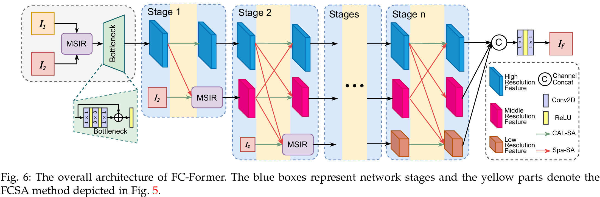
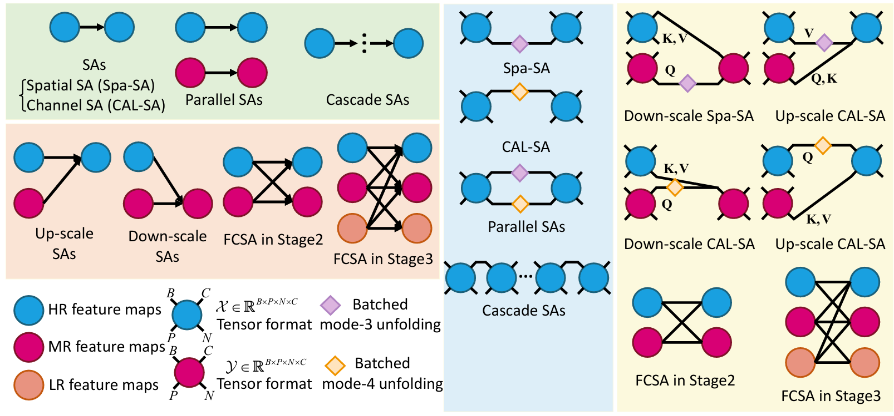

# Fully-Connected Transformer for Multi-Source Image Fusion

This repo is the official code of Fully-Connected Transformer for Multi-Source Image Fusion
(IEEE TPAMI, vol. 47, no. 3, pp. 2071-2088, 2025).

[[Paper](https://doi.org/10.1109/TPAMI.2024.3523364)] [[UDL](https://github.com/XiaoXiao-Woo/UDL)] [[PanCollection](https://github.com/XiaoXiao-Woo/PanCollection)] [[HyperSpectralCollection](https://github.com/XiaoXiao-Woo/HyperSpectralCollection)] [[MSIF](https://github.com/XiaoXiao-Woo/MSIF)]

## News🔥🔥🔥

* :art: FC-Former covers multiple multi-source image fusion scenes:
  * Multispectral and hyperspectral image fusion (MHIF);
  * Remote sensing pansharpening;
  * Visible and infrared image fusion (VIS-IR);
  * Digital photographic image fusion: multi-focus image fusion (MFF) and multi-exposure image fusion (MEF).

* :eight_pointed_black_star: **FC-Former employs multilinear algebra to unify and generalize self-attention mechanisms.**
  One of the generalized self-attention mechanisms is fully-connected self-attention (FCSA).

* 👍 FC-Former achieves state-of-the-art performance with fewer parameters and has strong potential in feature
  representation.

<div align="center"></div>

## Quick Start 🤗

1. Install the training/inference framework [UDL](https://github.com/XiaoXiao-Woo/UDL) (`udl_vis`; it brings hydra, accelerate and h5py):
```bash
git clone https://github.com/XiaoXiao-Woo/UDL && pip install -e UDL
```

2. Install the task repo: [PanCollection](https://github.com/XiaoXiao-Woo/PanCollection) for pansharpening, or
[HyperSpectralCollection](https://github.com/XiaoXiao-Woo/HyperSpectralCollection) (`hisr`) for MHIF:
```bash
git clone https://github.com/XiaoXiao-Woo/PanCollection && pip install -e PanCollection
git clone https://github.com/XiaoXiao-Woo/HyperSpectralCollection && pip install -e HyperSpectralCollection
```

3. Then in this repository (PyTorch, einops, timm, safetensors):
```bash
pip install -e .
```

The released weights are in `weights/`: `fcformer_wv3.pth` (WorldView-3) and `fcformer_cave_x4.pth` (CAVE x4).

One script per task downloads the data, trains and tests:
```bash
bash scripts/run_wv3.sh                         # pansharpening: download + train + test the trained model
bash scripts/run_wv3.sh test                    # test weights/fcformer_wv3.pth
bash scripts/run_cave_x4.sh                     # MHIF: download + train + test the trained model
bash scripts/run_cave_x4.sh test                # test weights/fcformer_cave_x4.pth
NUM_GPUS=4 bash scripts/run_wv3.sh train        # train on 4 GPUs
```

## Data

Run the commands from the repository root, with the data under `data/` (or pass `data_root=<dir>`):

* Pansharpening: Hugging Face [elsting/PanCollection](https://huggingface.co/datasets/elsting/PanCollection)
  ([PanCollection](https://github.com/liangjiandeng/PanCollection)); its `training_data/` and `test_data/` go under `data/`:
```
data/training_data/train_wv3_9714.h5
data/test_data/test_wv3_multiExm1.h5            # reduced resolution
data/test_data/test_wv3_OrigScale_multiExm1.h5  # full resolution
```
* MHIF: Hugging Face [elsting/MHIF](https://huggingface.co/datasets/elsting/MHIF); its `cave/` goes under `data/MHIF/`:
```
data/MHIF/cave/train_cave(with_up)x4_rgb.h5
data/MHIF/cave/test_cave(with_up)x4_rgb.h5
```

## Train

Training and inference run through PanCollection (pansharpening) and HyperSpectralCollection (MHIF). The settings
are in `configs/fcformer_wv3.yaml` and `configs/fcformer_cave_x4.yaml`.

The model `FCFormer` is registered through `import_path` in each config, so the task repo needs no FCFormer entry
of its own:

```yaml
model_type: FCFormer
import_path: ["${hydra:runtime.cwd}", fcformer]
```

Before building the model, udl_vis adds the first entry to `sys.path` and imports the package named by the second.
`fcformer/__init__.py` then imports the adapter of the task repo that is loaded (`fcformer.tasks.pansharpening` for
PanCollection, `fcformer.tasks.hyperspectral` for HyperSpectralCollection), which registers `FCFormer`. Run the
commands from the repository root, or set the first entry to the absolute path of this repository. A model of your
own is registered the same way: point `import_path` to the folder holding a package that defines its builder.

We take Hugging Face `accelerate` as the backend, on one GPU or on N GPUs;
`samples_per_gpu` is the total batch, split over the N GPUs (it must be divisible by N), so the batch and the
learning rate mean the same for any number of GPUs:

```bash
accelerate launch --num_processes=1 $(which accelerate_pansharpening) \
  --config-path=$PWD/configs --config-name=fcformer_wv3 args.pretrained=null
```

```bash
accelerate launch --multi_gpu --num_processes=N $(which accelerate_pansharpening) \
  --config-path=$PWD/configs --config-name=fcformer_wv3 args.pretrained=null
```

```bash
accelerate launch --multi_gpu --num_processes=N $(which accelerate_mhif) \
  --config-path=$PWD/configs --config-name=fcformer_cave_x4 args.pretrained=null args.flip_guide=false
```

## Inference

Set `eval=true` (test only) and the weights with `args.pretrained=<file>` (the released weights by default).

Pansharpening, full-resolution test set:
```bash
naive_pansharpening --config-path=$PWD/configs --config-name=fcformer_wv3 eval=true
```

Pansharpening, reduced-resolution test set:
```bash
naive_pansharpening --config-path=$PWD/configs --config-name=fcformer_wv3 eval=true \
  "dataset.wv3_test_path=[\${data_root}/test_data/test_wv3_multiExm1.h5]" base.test.test=reduce
```

One `output_mulExm_<k>.mat` (key `sr`, in the 0-2047 range of the data) is saved per test image, under
`results/pansharpening/wv3/fcformer_wv3/results/eval_1/full/` (`.../reduce/` for the reduced-resolution test).

MHIF on CAVE x4:
```bash
naive_mhif --config-path=$PWD/configs --config-name=fcformer_cave_x4 eval=true
```

One `output_mulExm_<k>.mat` (key `sr`, in [0, 1]) is saved per test image, under
`results/hisr/cave_x4/fcformer_cave_x4/results/eval_1/`. The released CAVE weights take the RGB channels in the
reverse order of the elsting/MHIF files, so the config sets `flip_guide: true` for testing them. A model trained
on these files uses `flip_guide=false` (`scripts/run_cave_x4.sh` sets it for any weights other than the released file).

## Use the network in your code

```python
import torch
from fcformer.tasks.pansharpening import FCFormerPansharpening

model = FCFormerPansharpening(spectral_num=8).eval()  # WorldView-3: 8 bands + PAN
fused = model.val_step({
    "ms": torch.rand(1, 8, 64, 64),      # low-resolution multispectral image
    "lms": torch.rand(1, 8, 256, 256),   # ms upsampled to the PAN size
    "pan": torch.rand(1, 1, 256, 256),   # panchromatic image
})
```

The spatial size must be divisible by the window size of each branch (16 / 8 / 4 by default).
For MHIF, use `fcformer.tasks.hyperspectral.FCFormerHyperspectral` with the data keys `lrhsi`, `up`, `rgb` and `gt`.

<div align="center"></div>

The form of attention is set by a reordering vector i and a mode k (Definition 2 and Theorem 2,
1-based), which Eq. (6) writes for FCSA. Here every form uses one layout of the factors,
B x d x P x S x C (batch, heads, blocks, positions, channels); Patch-SA merges S and C into SC. The
examples of Section III-A write each attention on its own layout, so their vectors differ from the ones
below: channel self-attention on B x d x C x S with i = (1, 2, 3, 4), k = 4 is CAL below with P = 1, and
patch self-attention on B x d x P x S x C unfolded to Bd x P x SC is PATCH below. Several forms in one
argument give one Z_k each, and the Z_k are summed (Algorithm 1):

```python
from fcformer import FCFormer
from fcformer.model.generalized_attention import BilinearAlign

SPA = ((1, 2, 3, 4, 5), 5)    # BdP x S x C: A relates positions
CAL = ((1, 2, 3, 5, 4), 5)    # BdP x C x S: A relates channels
PATCH = ((1, 2, 3, 4), 4)     # Bd x P x SC: A relates blocks

FCFormer(spectral_num=8)                                    # default: CAL-SA in each branch, Spa-SA across branches (Table VI row VI)
FCFormer(spectral_num=8, in_scale=(SPA,))                   # Spa-SA in each branch
FCFormer(spectral_num=8, in_scale=(PATCH,))                 # Patch-SA in each branch
FCFormer(spectral_num=8, in_scale=(), cross_scale=(CAL,), align=BilinearAlign)
FCFormer(spectral_num=8, in_scale=(CAL, SPA), cross_scale=(CAL, SPA), align=BilinearAlign)  # FCSA: CAL-SA + Spa-SA in and across branches
FCFormer(spectral_num=8, in_scale=lambda stage, branch: (SPA,) if stage == 3 else (CAL,))   # per stage / per branch
```

Across branches the token count of CAL-SA differs, so `align` resizes the other branch first.
Published weights exist for the default only.

## Experiments

The paper conducts experiments in the following cases:
* MHIF: CAVE and Harvard. See [HyperSpectralCollection](https://github.com/XiaoXiao-Woo/HyperSpectralCollection);
* Pansharpening: WorldView-3, GaoFen-2, QuickBird. See [PanCollection](https://github.com/XiaoXiao-Woo/PanCollection);
* VIS-IR image fusion: TNO and RoadScene (MSIF, coming soon);
* Digital photographic image fusion: MFF-WHU, MFF-Lytro, MEF-SICE, MEFB. See [MSIF](https://github.com/XiaoXiao-Woo/MSIF).

## Citation

Please cite this project if you use datasets or the toolbox in your research.

```bibtex
@article{wu2025fcformer,
  title   = {Fully-Connected Transformer for Multi-Source Image Fusion},
  author  = {Wu, Xiao and Cao, Zi-Han and Huang, Ting-Zhu and Deng, Liang-Jian and Chanussot, Jocelyn and Vivone, Gemine},
  journal = {IEEE Transactions on Pattern Analysis and Machine Intelligence},
  volume  = {47},
  number  = {3},
  pages   = {2071--2088},
  year    = {2025},
  doi     = {10.1109/TPAMI.2024.3523364}
}

@inproceedings{Wu_2021_ICCV,
  author    = {Wu, Xiao and Huang, Ting-Zhu and Deng, Liang-Jian and Zhang, Tian-Jing},
  title     = {Dynamic Cross Feature Fusion for Remote Sensing Pansharpening},
  booktitle = {Proceedings of the IEEE/CVF International Conference on Computer Vision (ICCV)},
  month     = {October},
  year      = {2021},
  pages     = {14687--14696}
}

@article{zhong2024ssdiff,
  title   = {SSDiff: Spatial-spectral Integrated Diffusion Model for Remote Sensing Pansharpening},
  author  = {Zhong, Yu and Wu, Xiao and Deng, Liang-Jian and Cao, Zihan},
  journal = {arXiv preprint arXiv:2404.11537},
  year    = {2024}
}

@article{duancvpr2024,
  title   = {Content-Adaptive Non-Local Convolution for Remote Sensing Pansharpening},
  author  = {Yule Duan, Xiao Wu, Haoyu Deng, Liang-Jian Deng*},
  journal = {IEEE/CVF Computer Vision and Pattern Recognition Conference (CVPR)},
  year    = {2024}
}

@article{dengijcai2023,
  title   = {Bidirectional Dilation Transformer for Multispectral and Hyperspectral Image Fusion},
  author  = {Shang-Qi Deng, Liang-Jian Deng*, Xiao Wu, Ran Ran, Rui Wen},
  journal = {International Joint Conference on Artificial Intelligence (IJCAI)},
  year    = {2023}
}

@misc{PanCollection,
  author = {Xiao Wu, Liang-Jian Deng and Ran Ran},
  title  = {"PanCollection" for Remote Sensing Pansharpening},
  url    = {https://github.com/XiaoXiao-Woo/PanCollection/},
  year   = {2022}
}
```

And some related works about image fusion may attract you:

```bibtex
@inproceedings{cao2024novel,
  title     = {A novel state space model with local enhancement and state sharing for image fusion},
  author    = {Cao, Zihan and Wu, Xiao and Deng, Liang-Jian and Zhong, Yu},
  booktitle = {ACM Multimedia 2024 (ACM MM)},
  year      = {2024}
}

@article{cao2024neural,
  title   = {Neural Shr$\backslash$" odinger Bridge Matching for Pansharpening},
  author  = {Cao, Zihan and Wu, Xiao and Deng, Liang-Jian},
  journal = {arXiv preprint arXiv:2404.11416},
  year    = {2024}
}

@article{cao2024diffusion,
  title     = {Diffusion model with disentangled modulations for sharpening multispectral and hyperspectral images},
  author    = {Cao, Zihan and Cao, Shiqi and Deng, Liang-Jian and Wu, Xiao and Hou, Junming and Vivone, Gemine},
  journal   = {Information Fusion},
  volume    = {104},
  pages     = {102158},
  year      = {2024},
  publisher = {Elsevier}
}
```

## License

This project is open sourced under GNU General Public License v3.0. Some parts are adapted from other projects under
the MIT license, see [THIRD_PARTY_NOTICES.md](THIRD_PARTY_NOTICES.md).
